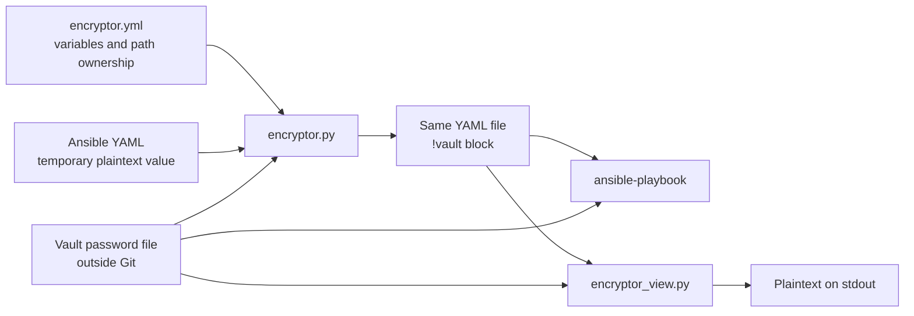

# ansible-encryptor

Developer-side tooling for encrypting selected Ansible YAML variables in place with
[Ansible Vault](https://docs.ansible.com/ansible/latest/vault_guide/index.html).

The encrypted value stays beside the rest of its configuration as a native `!vault` block, so
`ansible-playbook` can consume the file without a custom runtime plugin. The tool supports both a
single legacy vault and separate vault IDs for independently managed environments.

## What it provides

- In-place encryption of configured variable names in `.yml` and `.yaml` files.
- Idempotent handling of values that are already encrypted.
- A read-only command that decrypts one file to standard output.
- Per-environment vault IDs, password files, and owned path sets.
- Helpers for discovering a v2 configuration, checking path coverage, and rotating vault blocks.



## Security model

This tool protects secrets committed to Git; it is not a secret store or an authorization system.
Anyone with both the encrypted file and its vault password can decrypt the value.

- Keep vault password files outside the repository and restrict their permissions, for example
  with `chmod 600`.
- Never commit the temporary plaintext value. Run the encryptor before staging and inspect the diff.
- `encryptor_view.py` writes decrypted content to stdout. Do not run it in CI or a captured terminal
  unless exposing that output is acceptable.
- In legacy v1 mode, a missing password file triggers an interactive prompt and the entered password
  is written to the path from `ansible.cfg`. Pre-create that file with restrictive permissions.
- Run the tooling only against trusted repository content. It is an authoring helper, not a sandbox
  for untrusted YAML or configuration.

## Requirements

- A maintained Python 3 runtime. Razortheory consumers should use Python 3.9 or newer.
- Ansible, which provides `ansible.parsing.vault.VaultLib`.
- PyYAML.

Install the Python dependencies in an isolated environment:

```bash
python3 -m venv .venv
source .venv/bin/activate
python -m pip install --upgrade pip
python -m pip install -r requirements.txt
```

`requirements.txt` intentionally does not pin an Ansible release. The selected release determines
the exact controller-Python requirements; consuming repositories should pin and test that combination.

## Repository integration

A typical consumer includes this project as an `encryptor/` submodule next to its `ansible/`
directory:

```text
consumer-repository/
├── ansible/
│   ├── ansible.cfg
│   └── encryptor.yml
└── encryptor/
```

For example:

```bash
git submodule add git@github.com:razortheory/ansible-encryptor.git encryptor
git submodule update --init
```

The scripts accept the Ansible root as their first positional argument. Examples below assume the
layout above and are run from the consumer-repository root.

## Configuration

Create `ansible/encryptor.yml` and list every variable that must be encrypted.

### v1: one vault for the repository

```yaml
---
encrypted_variables:
  - SECRET_KEY
  - DATABASE_URL
  - SENTRY_DSN
```

In v1 mode, the encryptor:

1. Reads `[defaults] vault_password_file` from `ansible/ansible.cfg`.
2. Walks the conventional variable locations listed below.
3. Writes unlabeled `$ANSIBLE_VAULT;1.1;AES256` blocks.

The scanned locations are `env_vars/`, `group_vars/`, `host_vars/`, `inventories/`, `playbooks/`,
`roles/common/vars/`, and `roles/ansible-variables/vars/`, all relative to the Ansible root.

### v2: separate vaults by environment

```yaml
---
vault_groups:
  - vault_id: prod
    vault_password_file: ~/.ansible/myproject-prod.vault
    paths:
      - playbooks/prod
      - inventories/host_vars/prod-server.yml

  - vault_id: testnet
    vault_password_file: ~/.ansible/myproject-testnet.vault
    paths:
      - playbooks/testnet
      - inventories/host_vars/testnet-server.yml

encrypted_variables:
  - SECRET_KEY
  - DATABASE_URL
  - DISTRIBUTOR_SIGNER
```

Each group owns only its declared files and directories. Existing files are scanned recursively;
missing paths are ignored so a configuration may include forward-looking entries. A missing vault
password file skips that group with a warning. Encrypted output uses labeled
`$ANSIBLE_VAULT;1.2;AES256;<vault_id>` blocks.

The schemas are mutually exclusive at runtime: the presence of `vault_groups` selects v2 mode;
otherwise the tool uses legacy v1 behavior.

## Command reference

| Command | Purpose | Writes files |
|---|---|---:|
| `python encryptor/encryptor.py ansible` | Encrypt configured plaintext variables | Yes |
| `python encryptor/encryptor_view.py ansible <relative-yaml-path>` | Render one file with available vault blocks decrypted | No; prints plaintext |
| `python encryptor/encryptor_init.py ansible` | Generate a proposed v2 configuration on stdout | No |
| `python encryptor/encryptor_check.py ansible` | Validate v2 declarations, overlaps, and secret coverage | No |
| `python encryptor/encryptor_rotate.py ansible` | Re-encrypt v2 blocks under their owning vault IDs | Yes |
| `python encryptor/encryptor_rotate.py ansible --from-vault <path>` | Add a source password while rotating; repeatable | Yes |

### Encrypt a new variable

1. Add its exact name to `encrypted_variables`.
2. Add the temporary plaintext value to a supported YAML file.
3. Run `python encryptor/encryptor.py ansible`.
4. Verify that the value became a `!vault` block and inspect `git diff`.
5. Commit only the encrypted result.

Already encrypted blocks are skipped, so repeated runs are safe for unchanged content.

### View an encrypted file

The file path is relative to the Ansible root:

```bash
python encryptor/encryptor_view.py \
  ansible \
  playbooks/testnet/group_vars/all/django_variables.yml
```

In v2 mode the command loads every locally available group password. Missing password files are
reported and skipped. If no group passwords are available, it falls back to the legacy
`vault_password_file` from `ansible.cfg`.

## Migrating from v1 to v2

1. Generate a starting configuration and review it; the command does not modify `encryptor.yml`:

   ```bash
   python encryptor/encryptor_init.py ansible > /tmp/encryptor-v2.yml
   ```

2. Copy the reviewed `vault_groups` into `ansible/encryptor.yml` and create each password file:

   ```bash
   umask 077
   head -c 32 /dev/urandom | base64 > ~/.ansible/myproject-testnet.vault
   ```

3. Rotate existing blocks. The legacy password from `ansible.cfg` is included in the decryption
   pool when its file exists:

   ```bash
   python encryptor/encryptor_rotate.py ansible
   ```

4. Check ownership and coverage, then inspect the rewritten YAML:

   ```bash
   python encryptor/encryptor_check.py ansible
   git diff --check
   git diff -- ansible
   ```

To rotate a group's password, point the group at the new password file and provide the old file as a
source:

```bash
python encryptor/encryptor_rotate.py \
  ansible \
  --from-vault ~/.ansible/myproject-testnet-old.vault
```

A block with the target vault ID is skipped only when the current target password can decrypt it.
Otherwise it is decrypted with an available source password and re-encrypted with the target password.
Verify new-password decryption, old-password rejection, and unchanged plaintext values after rekeying.
Keep the old password while another repository or a required historical revision depends on it.
Rekeying current files does not revoke access to old ciphertext in Git history or backups.

## Parsing and behavior limitations

- Variable matching is regex-based and expects an unindented `NAME: value` line.
- Input values may be inline scalars or block scalars. Folded `>` input is normalized using literal
  `|` semantics during encryption, so whitespace-sensitive secrets require review.
- `encrypted_variables` values are interpolated into the matching regular expression and should be
  conventional YAML variable names.
- v2 path overlaps are ambiguous. `encryptor_check.py` reports files claimed by multiple groups as
  errors.
- Files outside all v2 group paths are not encrypted or rotated. The coverage checker reports
  plaintext configured variables as errors and existing vault blocks as warnings.
- `encryptor_rotate.py` is available only in v2 mode.

## Development checks

Run the focused rotation tests, a syntax check, and any additional workflow checks against disposable
fixture files. This repository currently has no CI workflow.

```bash
python3 -m unittest discover -s tests -v
python3 -m py_compile \
  encryptor.py \
  encryptor_check.py \
  encryptor_init.py \
  encryptor_rotate.py \
  encryptor_view.py
```

Never use production-only vault material as a development fixture.

## License

No license file is currently included in this repository.
